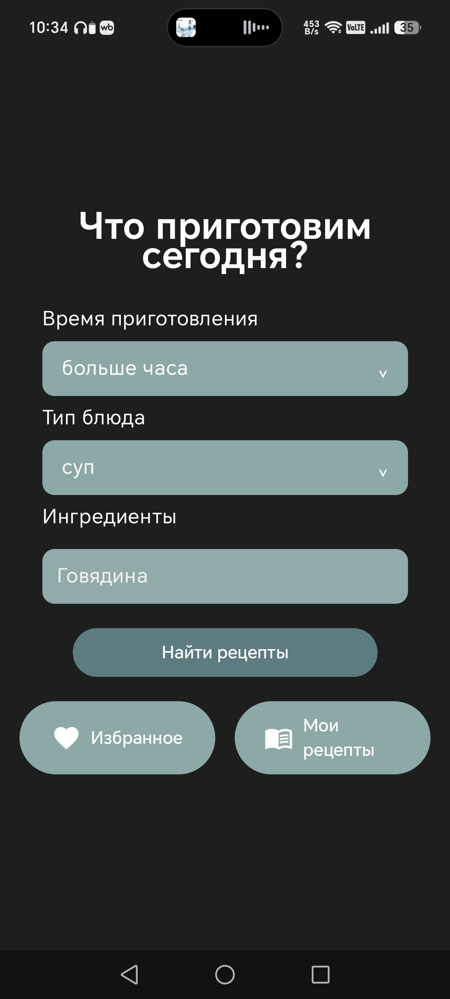
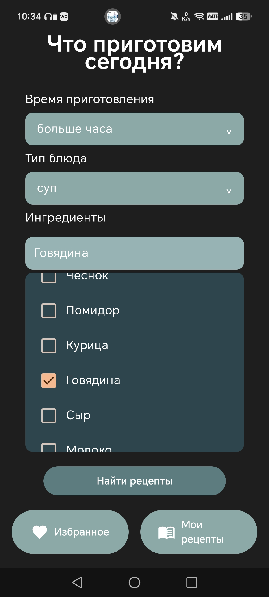
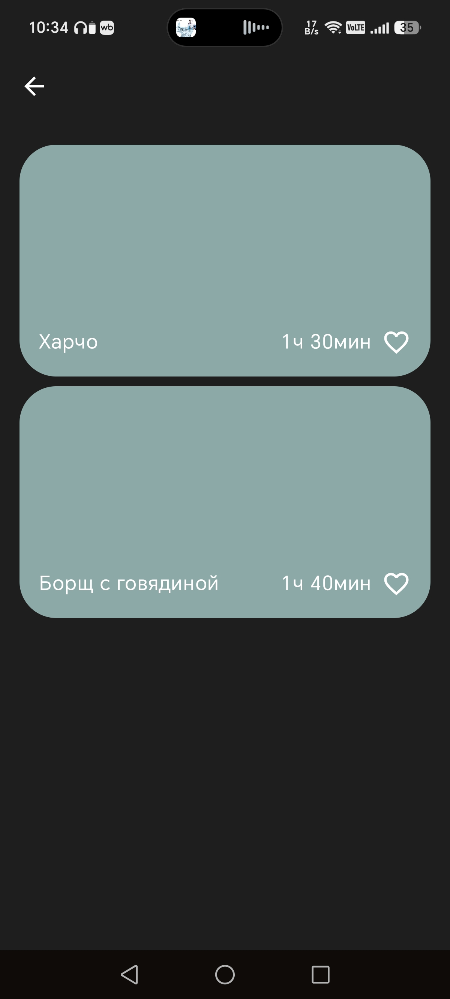
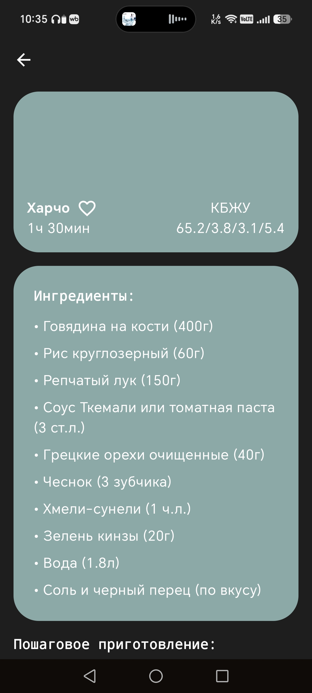
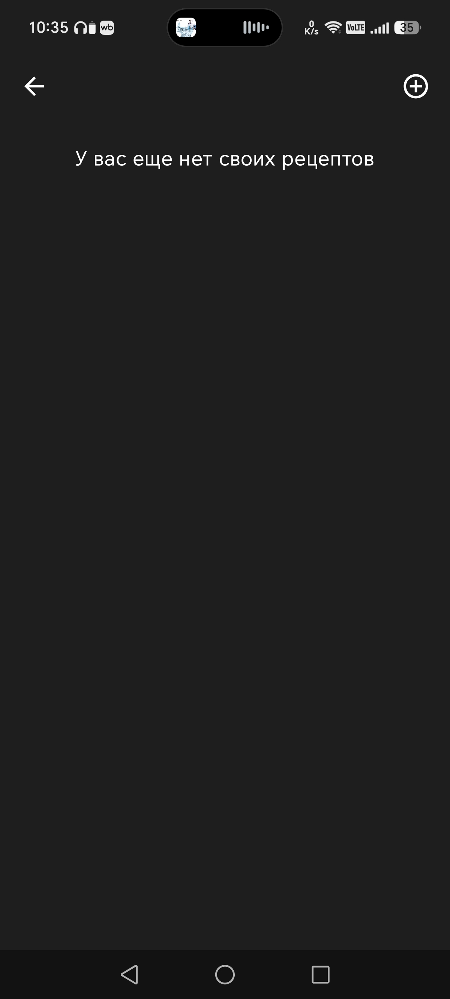
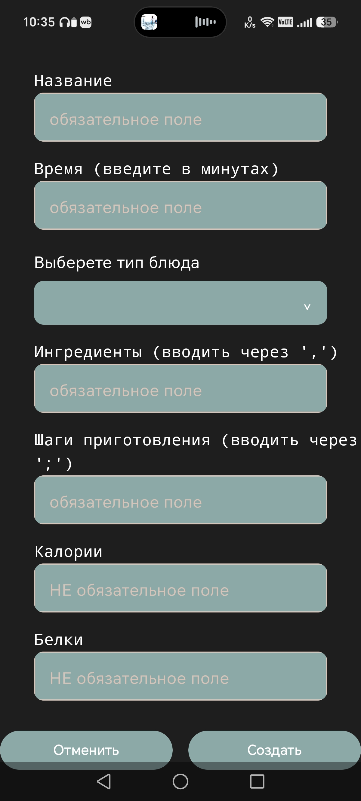
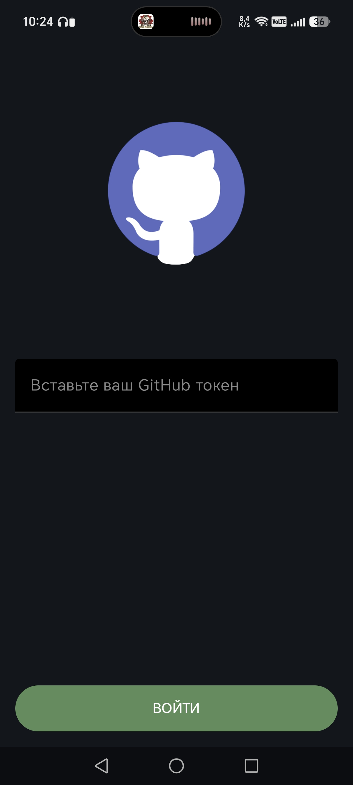
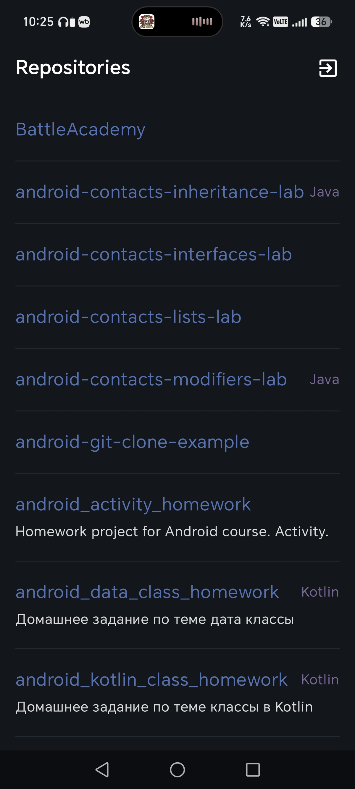

  

# VICTORIA ZABELINA

**Junior Android Developer · Kotlin · Jetpack Compose**

`building reliable mobile systems, one commit at a time`

🌲 Learning · Building · Exploring Android Architecture 🌲

---

## 🛠️ Стек технологий

  
  
  
   
  
  
  
   
  
  

---

## 📁 Мои Проекты

<pre>~/repositories</pre>

<!-- ПРОЕКТ 1 -->

<b>$ cat galya_zhrat.sh</b>

 
<blockquote>
<b>ГАЛЯ, ЖРАТЬ!</b> — Android-приложение для поиска рецептов и организации домашней кулинарной коллекции.
  
<b>📱 ТЕХНИЧЕСКИЕ ФИЧИ (SYSTEM CORE):</b> 
- <b>Recipe Discovery:</b> Подбор рецептов по времени приготовления, типу блюда и доступным ингредиентам. 
- <b>Personal Recipe Collection:</b> Создание и сохранение собственных рецептов с ингредиентами, пошаговыми инструкциями и пищевой ценностью. 
- <b>Local Data Persistence:</b> Локальное хранение пользовательских рецептов с использованием Room. 
- <b>Modern Android Stack:</b> Разработка UI на Kotlin и Jetpack Compose с архитектурой MVVM и управлением состоянием через ViewModel. 
- <b>Navigation & UI:</b> Навигация между экранами приложения и декларативный интерфейс с использованием Navigation Compose и Material 3. 
  

  

  

  
<a href="https://github.com/victo-zabel/GalyaZhrat">🔗 Исходный код проекта</a>
</blockquote>

<b>$ cat git_repo_viewer.sh</b>

 
<blockquote>
<b>GitRepoViewer</b> — Android-приложение для просмотра GitHub-репозиториев и информации о них.
  
<b>📱 ТЕХНИЧЕСКИЕ ФИЧИ (SYSTEM CORE):</b> 
- <b>GitHub API Integration:</b> Получение данных о пользователях, репозиториях и их содержимом через GitHub REST API. 
- <b>Networking & Serialization:</b> Сетевые запросы с использованием OkHttp и обработка JSON-ответов с помощью Kotlin Serialization. 
- <b>Authentication:</b> Авторизация с использованием токена GitHub и его локальное хранение в SharedPreferences. 
- <b>Modern Android Stack:</b> Разработка интерфейса на Jetpack Compose с использованием ViewModel для управления состоянием экранов. 
  

  
<a href="https://github.com/victo-zabel/GitRepoViewer">🔗 Исходный код проекта</a>
</blockquote>

<b>$ cat sign_language_learning.sh</b>

 
<blockquote>
  <b>Sign Language App</b> — Мобильное приложение для изучения русского жестового языка и дактильной азбуки.
    
  <b>📱 ТЕХНИЧЕСКИЕ ФИЧИ (SYSTEM CORE):</b> 
  - <b>Interactive Learning:</b> Модульная система уроков и уровней с последовательной блокировкой/разблокировкой контента. 
  - <b>Knowledge Testing:</b> Модуль тестирования и проверки знаний для отслеживания текущего прогресса пользователя. 
  - <b>Modern Stack & Storage:</b> Декларативный UI на Jetpack Compose (Material 3) и локальная база данных Room для сохранения прогресса. 
    
  <a href="https://github.com/victo-zabel/Sign-Language-Learning-App">🔗 Исходный код проекта</a>
</blockquote>

---

## 📊 Статистика GitHub

  

  

---

## 📫 Связь со мной

  
  

